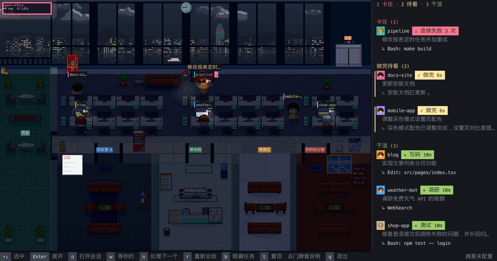

# agent-office

[](https://github.com/tyler-y-liu/agent-office/releases)
[](LICENSE)
[](#requirements)
[](https://www.rust-lang.org)

English | [简体中文](README.zh-CN.md)

**Every coding-agent session, as a little worker in one pixel office.** agent-office is an always-on-top window on Victoria Harbour that shows what each Claude Code, Codex, Cursor or DeepSeek Harness session is doing right now — who is working, who is waiting for your approval, who is stuck — and takes you back to that session in one double-click.



*A night shift in the office, driven by demo sessions.*

**Jump to:** [Setup](#setup) · [The office](#the-office) · [Keys](#keys) · [Roles](#roles) · [Configuration](#configuration) · [Privacy](#privacy) · [Development](#development)

## Why this exists

With several agent sessions running at once, it's hard to keep track of which one finished, which one is waiting for you to click "Allow", and which one has been going in circles for ten minutes. agent-office puts them all in one office, so the state of your whole fleet is one glance away.

## What you get

- **One-line summaries**: reads each session's latest prompt, todos and recent actions, and summarizes them in one short line through an OpenAI-compatible API you configure. When a turn ends it summarizes the result too: what got done, where it got stuck, or what it is asking you.
- **Seats by state**: working sessions sit at their desks; sessions waiting for approval, asking you a question or finished with a result you have not read queue in your office; ones you have read rest in the pantry; stuck ones stay at their desk in a red ring with a "⚠" by their name tag. A turn that ended with work still open is neither: a plan with an item in progress keeps its session at its desk as working, and one that stopped short of finishing — a Cursor turn you aborted, or one that errored — rests as idle. Neither queues in your office to be read.
- **Stuck detection**: 3 failures in a row, or no new activity for 5 minutes while working (20 minutes while a shell command is running; a session waiting on its own subagent isn't timed), marks a session as possibly stuck.
- **Notifications**: when the window is in the background and a session starts waiting for you, you get a system notification. The Dock badge always shows how many are waiting.
- **Jump back**: double-click a worker or card to open that session in the Claude desktop app, or bring forward the terminal it runs in.
- **Several agents**: Claude Code, Codex, Cursor (`cursor-agent`) and DeepSeek Harness (dsh) in the same office.

### At a glance

| You see | It means |
|---|---|
| `!` over a worker | Waiting for your approval |
| `?` over a worker | Asking you a question |
| Red ring, `⚠` by the name tag | Possibly stuck: repeated failures or a long silence |
| In **Your office** | Needs you: approvals first, then questions, then unread results |
| In the **pantry** | Read, or finished over 15 minutes ago unread |
| On the **rooftop** | Idle over 30 minutes (wide windows only) |

The side panel groups everyone the same way: waiting → stuck → done, unread → working → idle. The UI comes in English and Simplified Chinese, following your macOS language; press `l` in the window to switch (saved for the next start), or set `AGENT_OFFICE_LANG`.

## Setup

### Requirements

- macOS (the only platform it has been used on)
- Rust 1.95 or newer, only when building from source
- Optional: an OpenAI-compatible chat completions endpoint for summaries. Without one it still works, and the panel shows each session's raw prompt.

### Install

```bash
brew install tyler-y-liu/tap/agent-office
```

Other ways in:

```bash
cargo install --git https://github.com/tyler-y-liu/agent-office
```

Each [release](https://github.com/tyler-y-liu/agent-office/releases) also has a universal binary for Apple Silicon and Intel. The binary embeds the OFL-licensed Fusion Pixel font, so the third-party notices ship with it: `licenses/` inside the tarball, or `$(brew --prefix)/share/agent-office/THIRD-PARTY-NOTICES.md` after Homebrew.

### Connect your agents

Claude Code needs a step of its own:

```bash
agent-office connect      # hooks into ~/.claude/settings.json (backs it up first); new sessions only
```

The other three, each only if you run that agent:

| Agent | Setup | Notes |
|---|---|---|
| Codex | `agent-office connect codex` to see approval waits; sessions show up without it | Reads `$CODEX_HOME/sessions` (default `~/.codex/sessions`). `connect` puts a plugin in `~/.config/agent-office/codex-plugin` and installs it with `codex plugin`; needs `codex` on PATH |
| Cursor (`cursor-agent`) | `agent-office connect cursor` | Adds hooks to `hooks.json` in the Cursor config directory (default `~/.cursor`; backs it up first). Cursor's own transcripts have no tool calls, so the hook keeps a task log in `~/.config/agent-office/cursor/transcripts/` |
| DeepSeek Harness (dsh) | `agent-office connect dsh` | Writes a plugin to `$DSH_HOME` (default `~/.dsh`) and adds it to `cordis.patch.yml`; restart DSH. The plugin keeps a task log in `$DSH_HOME/agent-office/transcripts/` |

Setup applies to sessions started afterwards. Without hooks it still works, from session transcripts alone, but then it can't tell when a session is waiting for your approval. `agent-office disconnect [codex|cursor|dsh]` removes a setup and keeps the logs.

Hooks point at wherever the binary was when you ran `connect`, so run `connect` again after moving or reinstalling it somewhere else — a Homebrew upgrade keeps the same path, see [Update](#update).

Task logs hold only your prompts, the agent's replies, todos, and the path or command of each tool call. They contain no file contents or tool output. A log untouched for 30 days is deleted.

### Install the roles (optional)

```bash
agent-office roles install                  # nine roles for Claude Code
agent-office roles install --agent dsh      # the same roles as DeepSeek Harness presets (needs connect dsh, then restart DSH)
agent-office roles install --agent cursor   # the same roles as Cursor agents
```

The office opens without them. They are what [`p`](#roles) dispatches: a dispatch without them stops with a hint to run this.

### Turn on summaries (optional)

Put these in `~/.config/agent-office/env` (or set them as environment variables):

```bash
AGENT_OFFICE_API_BASE=https://your-gateway.example.com
AGENT_OFFICE_API_KEY=sk-...
AGENT_OFFICE_MODEL=your-model
```

Requests go to `<base>/v1/chat/completions`, or to `<base>/chat/completions` when the base already names an API version (`/v1`, `/api/v3`, `/v1beta/openai`, ...). Pick a fast model without long reasoning. For no summaries at all, `AGENT_OFFICE_SUMMARY=off` keeps every session's content on your machine.

### Check it works

```bash
agent-office                 # the window, always on top of the others (`t` toggles that, `q` twice quits)
agent-office doctor          # session directories, each agent's hooks, the socket, the stuck
                             # thresholds and one test call to the summary endpoint
agent-office --version       # what you actually have installed
```

macOS asks for permissions the first time something needs them, not at install time:

| Permission | Needed for |
|---|---|
| Screen Recording | Dispatching to Cursor's Agents window, which agent-office confirms by window title |
| Automation (Terminal, iTerm2) | Jumping to a session's tab |
| Notifications | The "waiting for you" notification — it arrives as "Script Editor" |

### Update

```bash
brew update && brew upgrade agent-office          # Homebrew
cargo install --git https://github.com/tyler-y-liu/agent-office --force    # from source
```

`brew update` first: brew reads its own clone of the tap, and `brew upgrade` alone can still see the previous release there. With `cargo install`, `--force` is what replaces an existing binary — without it, cargo says the package is already installed.

Hooks keep working through a Homebrew upgrade: `connect` records the `opt` link, which follows the upgrade, rather than the versioned `Cellar` directory that `brew upgrade` deletes. A tarball you moved yourself is the case that needs `connect` again.

Then quit the window (`q` twice) and start it again — the running window is the old build.

## The office

A row of four-person desks runs under the north windows, with a corridor in the middle. Along the south side, west to east: meeting room A, meeting room B (and C when the window is wide enough), the pantry, and your office. A wide window adds a rooftop terrace at the west end. Click a door sign to see what that area is for.

| Where | Who |
|---|---|
| Desks | Working sessions. Sessions from the same repo share a desk row, with matching colours on their name tags and panel avatars |
| Meeting rooms | A session whose subagent has run for 15 seconds goes there with it |
| Your office | Everything that needs you: approval waits over 20 seconds first, then questions to you, then finished results you have not read, each in the order they came. The first in line sits in the visitor chair and is the one `n` opens; the rest sit on the sofas, then stand in the corridor outside. A subagent waiting for approval does not queue here: it stays with its team or at its desk, a "!" over its head, though `n` still takes it first |
| Pantry | Read, or finished over 15 minutes ago unread: resting here |
| Rooftop | Idle over 30 minutes |

The rooftop appears only when the office is at least 200 columns wide. Without a rooftop they go to the window sofa; at lunch or in a typhoon the rooftop closes and resting ones are all in the pantry. When the desks fill up, a new floor opens; switch with `[` and `]`.

A Claude Code session whose background command is still running stays at its desk, in the working group, until that command reports back — even if its turn has already ended. So does one whose todo list still has an item in progress: its card says `… on its plan`, and it holds that seat for an hour at most, so a host that died mid-plan does not keep a desk forever. A turn that ended without a result to read — a Cursor turn you aborted, one that errored — leaves the session idle rather than queued.

## Keys

| Key | Action |
|---|---|
| `↑` `↓` (or `k` `j`) | Select |
| `Enter` | Expand: full prompt + last 5 actions |
| `Esc` | Collapse, then deselect |
| `o` / double-click | Open the session |
| `n` / click the "Your office" sign | Open the next one (the one in the visitor chair) |
| `w` / click the panel title | Open the Claude desktop app's list of sessions waiting for input |
| `p` | Dispatch a role (see [Roles](#roles)) |
| `r` | Summarize again |
| `b` | Toggle the labels over heads |
| `[` `]` (or `PageUp` `PageDown`) | Change floor |
| `t` | Toggle always-on-top |
| `l` | Switch between English and Chinese, saved to `~/.config/agent-office/env` |
| `q` twice | Quit |

Click a card or worker to select it; scroll the panel with the mouse wheel. After a notification, coming back to the window selects the first session waiting for you, so `o` goes straight to it.

`agent-office --shot out.png` runs for 20 seconds, saves the frame as a PNG and exits.

## Roles

`agent-office roles install` installs nine roles as Claude Code agents (`~/.claude/agents/office-*.md`): product, UX, architect, frontend, backend, QA, devops, reviewer and a PM that splits work among the others. `--agent dsh` installs them as DeepSeek Harness Agent Presets, which you can also choose directly in DSH's preset picker (run `agent-office connect dsh` as well, then restart DSH). `--agent cursor` installs them as Cursor agents (`~/.cursor/agents/office-*.md`, honouring `CURSOR_CONFIG_DIR`); new `cursor-agent` runs see them, and a file of the same name in a project's `.cursor/agents/` overrides one here. A session started in a role wears its chip on its badge and card; a PM's todo list shows as its plan on its card and on the meeting room's whiteboard. In DSH, the PM delegates with `subagent` and `agent_preset`; in Cursor, with the Task tool. Dispatching to Cursor needs the Cursor app or the Cursor CLI (`cursor-agent`), plus `agent-office connect cursor`; the hooks cover chats in the app and `cursor-agent` runs alike.

Press `p` to dispatch one. A digit picks the role; the host follows the worker you started from (or the latest one when none is selected), and `h` cycles it through Claude Code, DeepSeek Harness and Cursor, skipping any that is not set up — `AGENT_OFFICE_DISPATCH_HOST` sets where it opens. In Claude, the desktop app opens a new session with the prompt filled in, for you to send:

- On a finished or stuck card, it is a relay: the posts to hand on to come first, marked, and the task carries what the session was asked, what it came to and where its changes are.
- Anywhere else it opens a fresh session in that worker's repository (with none selected, the latest one's) and asks you for its task; until you give one it queues in your office.

A dispatch goes into the picked worker’s directory: a relay uses that worker’s own cwd (a worktree, where its changes are), a fresh session uses its repository root (`project_root`), and a directory that is not there is an error rather than a silent substitution. DSH groups sessions into workspaces by directory, so the new session lands in that directory’s workspace, not the one you have open — the bar names the repository before you click.

The panel keeps a row of posts at its foot: one click dispatches to that post, the row starts with the repository and ends with one chip per host (Claude, DSH, Cursor): click a host to send there, and that choice holds for the rest of the run (`AGENT_OFFICE_DISPATCH_HOST` sets the lasting default). A new host is one entry in `Backend::ALL` — the row grows a chip for it. `p` still opens the picker when you want to re-read a relay’s suggestions.

DSH dispatch goes through its running Host: a relay is created and submitted directly; a fresh dispatch creates a blank role session for you to open from DSH's session list and give a task. It raises the Harness window (`dsh://open`) once the session exists, so the new session is at the top of its list; it does not support `--terminal`. Only an unclaimed request is retracted on timeout. Once a Host accepts it, the client keeps waiting for the eventual result and session id. If the Host exits mid-dispatch the outcome is unknown; check DSH's session list before retrying. A request already expired before a Host starts work is refused instead.

Cursor dispatch carries the role's brief in the prompt (Cursor cannot start a chat as a named agent). A dispatch, a relay included, opens Cursor's Agents window with the prompt filled in: click Create Chat, pick the repository (the note says which) and write the task or just send. The Agents window takes no folder, so the prompt ends with the working directory for the agent to work in, a relay's worktree included. The prompt is sent only once the Agents window is in front, which agent-office checks by window title and so needs Screen Recording permission. When the app is not installed, its link cannot carry the prompt as it is, or the Agents window cannot be confirmed in front, it falls back to a new Terminal.app window that starts `cursor-agent` in the target directory and submits straight away (this needs the Cursor CLI), and the note says why. Double-clicking a Cursor chat from the app opens it in the Agents window; a `cursor-agent` run switches to its terminal. The PM needs the Cursor roles installed. From the command line, `--terminal` starts `cursor-agent` in the current terminal instead of a new window.

From a terminal: `agent-office dispatch --role qa "run the full test suite"` (`--dir`, `--terminal`, `--auto` for the PM). Add `--agent dsh` for DeepSeek Harness or `--agent cursor` for Cursor. `agent-office roles remove [--agent dsh|cursor]` takes the selected host's roles out again without changing the other hosts.

## Configuration

All settings are environment variables. The three summary variables and `AGENT_OFFICE_WEATHER` are also read from `~/.config/agent-office/env` (one `KEY=value` per line) when they aren't set.

| Variable | Effect |
|---|---|
| `AGENT_OFFICE_API_BASE` / `_API_KEY` / `_MODEL` | Summary endpoint. Summaries are on only when all three are set |
| `AGENT_OFFICE_SUMMARY=off` | Send nothing out; the panel shows raw prompts |
| `AGENT_OFFICE_LANG` | UI and summary language: `en` or `zh`. Default: the macOS UI language, else `LANG`; anything but Chinese gets English |
| `AGENT_OFFICE_DISPATCH_HOST` | Where `p` dispatches by default: `claude`, `dsh`, `cursor`, or `follow` (default: the picked worker's host). A host that is not set up falls back to `follow` |
| `AGENT_OFFICE_NOTIFY=off` | No system notifications or Dock bounce; the badge still shows |
| `AGENT_OFFICE_SOUND=on` | Sound effects (off by default): a ding when a session starts waiting for approval, a pop with confetti |
| `AGENT_OFFICE_STUCK_FAILS` / `_STUCK_QUIET` / `_STUCK_QUIET_LONG` | Stuck thresholds: failures in a row (default 3), quiet minutes while working (default 5), quiet minutes during long calls (default 20). `doctor` shows the current values |
| `AGENT_OFFICE_THEME` | Theme: `harbour` (default) or `paper`, plus pixtuoid's `normal`, `cyberpunk`, `dracula`, `tokyo-night`, `catppuccin` and `gruvbox` |
| `AGENT_OFFICE_UTC_OFFSET` | Time zone for the sky, lunch, overtime and holidays, in seconds (default `28800`, Hong Kong) |
| `AGENT_OFFICE_WEATHER=hko` | Weather and typhoon signals from the Hong Kong Observatory's open data (one request every 10 minutes; sends nothing of yours) |
| `AGENT_OFFICE_SOCKET` | Hook socket path (default `/tmp/agent-office-<uid>/agent-office.sock`) |
| `AGENT_OFFICE_DEBUG=<file>` | Append every summary result to this file |

## Privacy

With summaries on, each session's prompts, todos, recent actions and the last reply of each turn are sent to **the endpoint you configured**. With no endpoint, or with `AGENT_OFFICE_SUMMARY=off`, no session content leaves your machine. There is no default endpoint in the code.

Daily stats are stored locally in `~/.config/agent-office/stats.json`.

## Limitations

<details>
<summary>What it can't do (yet)</summary>

- Only used on macOS.
- Jumping: sessions in the Claude desktop app open directly. For sessions in a terminal, the terminal comes to the front; iTerm2 and Terminal.app also switch to the right tab (macOS asks once for permission to control the terminal). Other terminals can't be taken to a specific tab.
- Sessions in tmux switch to their pane, but only on tmux's default socket (sessions started with `-L` / `-S` can't be found).
- Notifications go through `osascript`, so they appear as "Script Editor" in Notification Center and clicking one doesn't jump to the session; use the Dock icon or the window.
- It doesn't start at login, and it never checks for a newer release: installing it as a login item and running [Update](#update) are both up to you.
- It can run alongside pixtuoid; each uses its own socket and hooks.

</details>

<details>
<summary><b>Little details in the office</b></summary>

- **Harbour view**: the water and reflections, the skyline across the harbour with the ICC, Lion Rock, the Star Ferry, a red-sailed junk, jetfoils, black kites, blinking planes at night, and the Symphony of Lights at 8 pm. The sky follows Hong Kong time.
- **A Central office**: a Hang Seng ticker, a Guan Yu shrine, an arowana tank in the lift lobby, a cha chaan teng corner, money plants and a waving lucky cat, and a shop cat that wanders around.
- **Workers**: workers from the same repo always look the same; Codex workers wear caps, Cursor workers wear headphones, dsh workers wear glasses.
- **Celebrations**: tests going green, `git push`, opening a PR, or finally passing after failures throws confetti, and coworkers clap.
- **Overtime**: after 30 minutes in one turn, or past 10 pm, a cup noodle and milk tea appear on the desk; at night only the overtime desks stay lit.
- **Stuck**: sweat for repeated failures, "…" for silence, a rain cloud when it lasts too long; the shop cat goes to sit at the feet of the worst-off worker.
- **Cantonese chatter**: meeting and pantry small talk is in Cantonese; on weekdays 12:30–13:30 idle workers head down to the cha chaan teng. Click an idle worker and it stretches or talks back.
- **Today's stats**: after 6 pm a neon board shows turns finished, stuck counts and tokens; click it for a 10-second replay of the day and an award ceremony.
- **Holidays**: Lunar New Year, Mid-Autumn and Christmas decorations.
- **Typhoons**: with `AGENT_OFFICE_WEATHER=hko`, signal No. 8 or above stops the ferry, closes the rooftop, and sends everyone packing.

</details>

## Development

```bash
cargo test --release
```

`vendor/` holds modified copies of pixtuoid's `pixtuoid-core` / `pixtuoid-scene` 0.21.0 and of softbuffer, wired in through `[patch.crates-io]` in `Cargo.toml`. Every change is marked `agent-office`. Read the pixtuoid crate's `AGENTS.md` before changing it.

The art scripts are in `tools/`: `people.py` draws the chibi workers and hairstyles, `hk_art.py` the cha chaan teng, plants and furniture colours. They read the upstream sprites from the cargo registry (if they aren't there, comment out `[patch.crates-io]` and run `cargo fetch` once), so they can be re-run. After changing art, run `SNAPSHOTS=overwrite cargo test --release` in `vendor/pixtuoid-scene` to update the pixel snapshots.

## Credits and license

agent-office is released under the MIT License; see [LICENSE](LICENSE).

- The office renderer, animation and data sources come from [pixtuoid](https://github.com/pixtuoid/pixtuoid) (MIT, Copyright (c) 2026 Ivan Wang). `src/pipeline.rs` is adapted from pixtuoid's `runtime/`, and the scaling and name-tag layout in `src/floating/mod.rs` follow pixtuoid.
- `vendor/softbuffer` comes from [softbuffer](https://github.com/rust-windowing/softbuffer) (MIT or Apache-2.0).
- The Fusion Pixel 8px font ships with pixtuoid-scene under the SIL OFL 1.1; see `assets/OFL-Fusion-Pixel.txt` and `assets/LICENSES-Fusion-Pixel/`.
