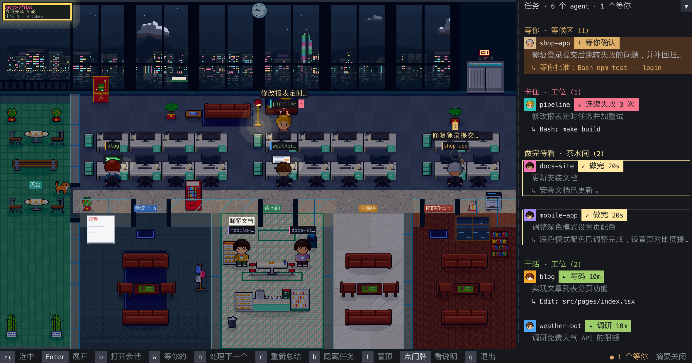

# agent-office

An always-on-top pixel office on Victoria Harbour for your Claude Code sessions: every session is a little worker, with a one-line AI summary of its current task over its head and in the side panel. It flags sessions waiting for your approval or likely stuck, and a double-click jumps back to that session in the Claude desktop app, or brings forward the terminal it runs in. macOS; Claude Code, plus DeepSeek Harness, Codex and Cursor (`cursor-agent`) sessions; the UI is in Chinese.



一个像素办公室窗口（按 `t` 置顶），开在维港边：每个 Claude Code 会话是一个小人，头顶和右侧任务栏写着它**正在做的任务（AI 一句话总结）**。双击小人就能跳回它所在的会话。

- 任务摘要：读每个会话的最新指令、进行中的 todo 和最近的动作，用你配置的 OpenAI 兼容接口总结成不超过 20 字的一句话；子 agent 直接用父 agent 派活时写的 description。
- 做完的结果：一轮结束后，再用同一个接口把它最后的回复总结成一句写在卡片上（做成了什么、卡在哪，或者「问：」它在等你回答什么），不用点开就知道先看哪个；展开卡片能看到最后回复的末尾。没配接口时显示回复开头。
- 阶段与卡点：按最近的工具调用标出调研 / 写码 / 测试 / 执行 / 派活；连续失败 3 次，或者在工作中却 5 分钟没有新动静（构建、子 agent 这类长调用放宽到 20 分钟），会标红为「可能卡住」。干活的卡片写着本轮跑了多久（从你最后一次发指令算起，满 1 分钟才显示）。
- 提醒：窗口不在前面时，有会话开始等你（等你批准超过 20 秒，或做完了在问你问题），就弹一条系统通知（会话名 + 任务摘要或它问的问题），Dock 图标跳一下；Dock 角标一直显示现在有几个在等你。点 Dock 图标回到窗口，会自动选中排在最前面的那个，按 `o` 就过去。打开窗口时已经在等的不会弹。
- 调度：双击小人或卡片（或选中后按 `o`）在 Claude 桌面 app 里打开那个会话（打开过的已完成会话算已看过：从茶水间去天台，侧栏移到「闲着」；在 Claude 桌面 app 里切到过它、或者 app 在前台时停在它上面看它做完，也算看过）；点任务栏标题（或按 `w`）打开「等你的会话」列表。
- 维港窗景：海面和倒影、对岸楼群和 ICC、狮子山山脊、天星小轮、鸭灵号红帆船、喷射飞航、盘旋的麻鹰，白天偶尔有直升机，夜里有闪灯的航班；每晚 8 点幻彩咏香江激光。天色按香港时间走，与本机时区无关。
- 中环写字楼：四人一排的屏风长桌、恒指报价屏、关公神台、你的办公室（真皮沙发、酸枝茶几、书柜、恒指屏）、电梯大堂的龙鱼缸、茶餐厅一角（面包柜、奶茶桶、马赛克柜台）、发财树 / 富贵竹 / 年桔 / 会招手的招财猫，还有一只到处巡的店猫。
- 谁在哪：干活的坐在自己仓库的那张长桌（同一个仓库的会话坐一起，人物名牌色条和侧栏头像同一种颜色；同名的会话按开启先后标 `·1`、`·2`）；做完的去茶水间等你看，你打开看过（侧栏标「✓ 已看」）或闲满 15 分钟就上天台；子 agent 跑满 15 秒就和父会话去会议室开会（之前只在父会话名牌上显示 +N）；等你批准超过 20 秒、或者做完了在问你问题（「问：」）的去等候区排队，等你批准的排前面、同类按先后，第一个坐你办公室的访客椅（点「你的办公室」门牌或按 `n` 直接打开它）；卡住的留在工位，红圈加红「?」。侧栏按「等你 → 卡住 → 做完待看 → 干活 → 闲着」分组。
- 平面：北面窗下一排四人长桌，中间一条走廊，南边从西到东是会议室 A、会议室 B、茶水间、等候区、你的办公室。窗口窄时依次砍掉天台、合并两间会议室、缩小茶水间。点门牌会弹出这块区域的说明（谁坐这里、什么时候换地方）。
- 天台：窗口够宽（200 列以上）时西端约八分之一变成露天天台，从办公室西墙的门出去；绿色防水漆地面、一张面朝海的木条长凳、两张大理石小圆桌、四角花盆。Q 版小人，挂工牌穿帽衫；同一个仓库的小人外形固定（衣服、发色、肤色、发型都跟仓库走），Codex 的戴鸭舌帽、Cursor 的戴耳机、dsh 的戴眼镜，一眼看得出来自哪里。
- 办公室里的动静：
  - 测试跑绿、`git push` 或开 PR、连续失败后终于过了，小人头上撒彩纸、亮一块「测试全过！」「已推送！」「终于过咗！」，翻身那次旁边的同事还会鼓掌。
  - 一轮跑满 30 分钟，或者香港时间晚上 10 点后还在干活，桌上多一碗杯面和一杯奶茶；夜里有人加班时，地板只剩加班的工位亮着。
  - 卡住的小人：连续失败时冒汗，没动静时冒「…」，卡太久头顶一朵下雨的乌云；店猫会过去蹲在最惨那个的脚边。
  - 你批了一个等你确认的会话，办公室门牌上冒出老板说「批咗！」。
  - 开会和茶水间的闲聊改成粤语，说它们手上的活；工作日 12:30–13:30 闲着的都下去茶餐厅点餐。
  - 换地方是走过去的：沿走廊走到会议室、等候区、茶水间，再走回工位；做完的端着一杯奶茶走去茶水间。
  - 单击店猫，它「喵～」一声；单击闲着的小人，它伸个懒腰，或者用粤语回你一句（「做紧嘢啊！」）。双击照旧打开会话。
  - 晚上 6 点后，墙上霓虹板显示今日战绩（完成轮数、卡住次数、token）；点它放一段 10 秒的当日回放：每小时完成的轮数逐格长出来，然后颁奖杯给今天完成最多的，再点名卡得最久的。再点一下办公室收起（记录在 `~/.config/agent-office/stats.json`）。
  - 农历新年挂挥春和炮仗，中秋挂灯笼，圣诞挂彩灯和圣诞树。
  - 设 `AGENT_OFFICE_WEATHER=hko` 后，窗外天气跟香港天文台走；挂起风球会出告示牌，8 号或以上天星停航、天台关闭、所有人收拾公事包。

## 安装

```bash
cargo install --path .
agent-office connect      # 往 ~/.claude/settings.json 加 hooks（先备份），新开的 Claude 会话生效
agent-office
```

不接 hooks 也能用，只靠会话记录，但看不到「等你确认」，底栏会提示没接 hooks。

DeepSeek Harness（dsh）的会话也能进办公室：

```bash
agent-office connect dsh   # 往 $DSH_HOME（默认 ~/.dsh）写插件，并挂进 cordis.patch.yml；新开的 dsh 进程生效
```

插件把会话事件发给 `agent-office hook --source dsh`，另外在 `$DSH_HOME/agent-office/transcripts/` 为每个会话记一份任务日志（你的指令、它的回复、todo、每次工具调用的路径/命令，不含文件内容和工具输出），摘要和卡点检测就读这份日志。`agent-office disconnect dsh` 卸掉插件，日志保留。可以和 pixtuoid 的 dsh 插件同时挂。

Codex 的会话不用接入也会进办公室：摘要和卡点读 `$CODEX_HOME/sessions`（默认 `~/.codex/sessions`）里的会话记录。要看到「等你确认」再接 hooks：

```bash
agent-office connect codex   # 在 ~/.config/agent-office/codex-plugin 放一个插件，用 codex plugin 命令装上；新开的 Codex 会话生效
```

`agent-office disconnect codex` 卸掉插件。需要 `codex` 在 PATH 上。

Cursor 的 `cursor-agent` 只能靠 hooks：

```bash
agent-office connect cursor  # 往 Cursor 配置目录（默认 ~/.cursor）的 hooks.json 加 hooks（先备份）；新开的 cursor-agent 生效
```

Cursor 自己的会话记录里没有工具调用，所以 hook 另外在 `~/.config/agent-office/cursor/transcripts/` 为每个会话记一份任务日志（内容同 dsh），摘要和卡点检测读它。`agent-office disconnect cursor` 移除 hooks，日志保留。

`agent-office disconnect` 移除 hooks。hooks 指向 `connect` 时这个程序所在的位置，移动或重装到别处后要重新 `connect`。

按键：`↑↓` 选中 · `Enter` 展开（完整指令 + 最近 5 个动作）· `o` 打开会话 · `w` 等你的会话 · `n` 处理下一个（打开坐访客椅的那个） · `r` 重新总结 · `b` 开关头顶标签 · `[ ]` 换楼层 · `t` 切换置顶 · `q` 退出。鼠标点卡片或小人选中，双击打开会话；鼠标滚轮或触控板在任务栏上滚动卡片。

```bash
agent-office doctor            # 检查会话目录、hooks、socket、摘要接口
agent-office --shot out.png    # 跑 20 秒后把画面存成 PNG 并退出
```

## 配置

| 环境变量 | 作用 |
|---|---|
| `AGENT_OFFICE_API_BASE` / `AGENT_OFFICE_API_KEY` / `AGENT_OFFICE_MODEL` | 摘要用的 OpenAI 兼容接口（`<base>/v1/chat/completions`）。环境变量没有时从 `~/.config/agent-office/env`（`KEY=value` 每行一个）读；三个都配了才开启摘要 |
| `AGENT_OFFICE_SUMMARY=off` | 不发任何内容出去，任务栏显示原始指令 |
| `AGENT_OFFICE_SOCKET` | hook socket 路径（默认在临时目录下的 `agent-office-$USER/`） |
| `AGENT_OFFICE_DEBUG=<file>` | 把每次摘要结果追加写到该文件 |
| `AGENT_OFFICE_THEME` | 换主题：默认 `harbour`，另有 `paper` 和 pixtuoid 自带的几套 |
| `AGENT_OFFICE_UTC_OFFSET` | 窗外天色、午饭、加班和节日用的时区，秒（默认 `28800`，香港） |
| `AGENT_OFFICE_SOUND=on` | 打开音效（默认关）：有人开始等你批准时「叮」一声，撒彩纸时轻轻「啵」一声。macOS 用 `afplay` 播放 |
| `AGENT_OFFICE_NOTIFY=off` | 不弹系统通知、Dock 图标不跳；Dock 角标照常显示 |
| `AGENT_OFFICE_STUCK_FAILS` / `AGENT_OFFICE_STUCK_QUIET` / `AGENT_OFFICE_STUCK_QUIET_LONG` | 「可能卡住」的门槛：连续失败几次（默认 3），工作中几分钟没动静（默认 5），构建、子 agent 这类长调用时几分钟（默认 20）。测试一跑半小时的仓库可以调大；`agent-office doctor` 显示当前值 |
| `AGENT_OFFICE_WEATHER=hko` | 窗外天气和风球跟香港天文台公开数据走（每 10 分钟请求一次，不发送你的任何内容）；不设就用随时钟轮换的天气 |

开启摘要时，会话的指令文本、todo、最近动作和一轮结束时的最后回复（dsh、Codex、Cursor 会话同样）会发到你配置的接口。没配就不发任何内容。挑一个回得快、不带长推理的模型。

## 限制

- 只在 macOS 上用过。
- 跳转：Claude 桌面 app 里的会话直接打开那个会话；终端里跑的会话（Claude Code、dsh、Codex、Cursor）把它所在的终端切到前台，iTerm2 和 Terminal.app 还会切到它那个标签页（第一次 macOS 会问是否允许 agent-office 控制该终端，不允许就只切到前台）；其他终端到不了具体标签页。在 tmux 里跑的会话：切到它的窗格，再把连着 tmux 的那个终端切到前台；只认默认 socket 的 tmux（`-L` / `-S` 起的找不到），tmux 没有终端连着时提示先 attach。Cursor 会话要等它调用过一次工具才能跳。
- 系统通知走 `osascript`，通知中心里显示的是「脚本编辑器」，点通知会打开脚本编辑器而不是跳到会话；要跳回去点 Dock 图标或窗口。
- 只显示 Claude Code、dsh、Codex 和 Cursor（`cursor-agent`）会话。
- 可以和 pixtuoid 同时运行，各用各的 socket 和 hooks。

## 美术与改动

`vendor/` 里是 pixtuoid 的 `pixtuoid-core` / `pixtuoid-scene` 0.21.0（MIT），改成了 agent-office 自己的样子，凡是改过的地方都标了 `agent-office`：

- `tools/people.py`：Q 版头、工牌、帽衫、球鞋，以及 9 种发型；
- `tools/hk_art.py`：茶餐厅、吉祥物和植物、桌子和文件柜的配色；
- `vendor/pixtuoid-scene/src/skyline/harbour.rs`：维港窗景；
- `theme/harbour.rs` / `theme/paper.rs`：两套主题；
- 布局（四人长桌）、马赛克地砖、招牌文字、香港时钟，改在 scene 源码里。

两个脚本读的是 cargo registry 里的上游原版 sprite（registry 里没有的话，临时注释掉 `Cargo.toml` 的 `[patch.crates-io]` 跑一次 `cargo fetch`，再改回来），所以可以重复运行。改完美术后，在 `vendor/pixtuoid-scene` 里运行 `SNAPSHOTS=overwrite cargo test --release` 更新像素金样。

## 致谢

办公室的渲染器、动画和数据源来自 [pixtuoid](https://github.com/pixtuoid/pixtuoid)，MIT License，Copyright (c) 2026 Ivan Wang；许可证全文见 `LICENSE`。

`assets/` 里的 Fusion Pixel 8px 字体随 pixtuoid-scene 发布，SIL OFL 1.1（见 `assets/OFL-Fusion-Pixel.txt` 和 `assets/LICENSES-Fusion-Pixel/`）。

`src/floating/mod.rs` 的缩放倍数、名牌版式按 pixtuoid 悬浮窗和 pixtuoid-scene 的 `display/compose.rs` 复刻；`src/pipeline.rs` 的接线改写自 pixtuoid（`crates/pixtuoid/src/runtime/`），MIT License，Copyright (c) 2026 Ivan Wang。
