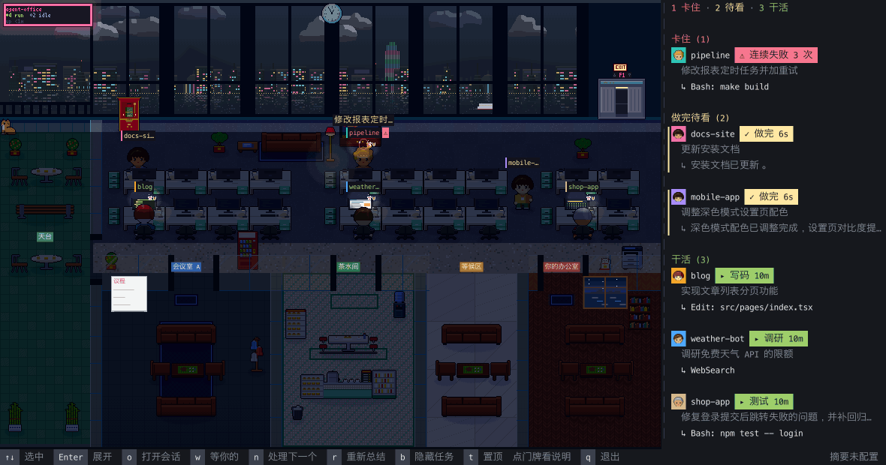

# agent-office

[English](README.md) | 简体中文

开在维港边的像素办公室，给你的 Claude Code 会话用。每个会话是一个小人，头顶写着它正在做什么。谁在等你批准、谁像是卡住了，一眼就看得到，双击就能跳回那个会话。



## 能做什么

同时开好几个 agent 会话时，很难记得哪个做完了、哪个在等你点「允许」、哪个已经原地打转十分钟。agent-office 把它们放进一间办公室：

- **一句话摘要**：读每个会话的最新指令、todo 和最近动作，用你配置的 OpenAI 兼容接口总结成不超过 20 字的一句话。一轮结束后再总结一句结果：做成了什么、卡在哪，或者它在问你什么。
- **按状态排座位**：干活的坐工位；等你批准（头顶「!」）、在问你问题（头顶「?」）或做完了你还没看的，到你的办公室排队；看过的去茶水间歇着；卡住的留在工位、红圈围着、名牌旁标「⚠」。侧栏按「等你 → 卡住 → 做完待看 → 干活 → 闲着」分组。
- **卡点检测**：连续失败 3 次，或者在干活却 5 分钟没新动静（在跑命令行时放宽到 20 分钟；Claude Code 会话在等自己的子 agent 时不计时），标红为「可能卡住」。
- **提醒**：窗口不在前面时，有会话开始等你，就弹一条系统通知；Dock 角标一直显示有几个在等你。
- **一键跳回**：双击小人或卡片，在 Claude 桌面 app 里打开那个会话，或者把它所在的终端切到前台。
- **多种 agent**：Claude Code、Codex、Cursor（`cursor-agent`）和 DeepSeek Harness（dsh）。

界面有简体中文和英文两种，默认跟随 macOS 的系统语言；在窗口里按 `l` 切换（下次启动也是这种语言），也可以用 `AGENT_OFFICE_LANG` 指定。

## 环境要求

- macOS（目前只在 macOS 上用过）
- Rust 1.95 或更新（只有从源码编译才需要）
- 可选：一个 OpenAI 兼容的 chat completions 接口，用来生成摘要。不配也能用，任务栏会显示原始指令。

## 快速开始

```bash
brew install tyler-y-liu/tap/agent-office
agent-office connect      # 往 ~/.claude/settings.json 加 hooks（会先备份），新开的 Claude 会话生效
agent-office
```

也可以从源码编译：`cargo install --git https://github.com/tyler-y-liu/agent-office`。每个 [release](https://github.com/tyler-y-liu/agent-office/releases) 也附了 universal 二进制（Apple Silicon 和 Intel 通用）。

开启摘要：在 `~/.config/agent-office/env` 里写上（或者设成同名环境变量）：

```bash
AGENT_OFFICE_API_BASE=https://your-gateway.example.com
AGENT_OFFICE_API_KEY=sk-...
AGENT_OFFICE_MODEL=your-model
```

请求发到 `<base>/v1/chat/completions`；base 里已经带版本段（`/v1`、`/api/v3`、`/v1beta/openai` 等）时发到 `<base>/chat/completions`。挑一个回得快、不带长推理的模型。

有问题先跑 `agent-office doctor`，它会检查会话目录、各 agent 的 hooks、socket 和卡点门槛，并试调一次摘要接口。

不接 hooks 也能用，只靠会话记录，但看不到「等你确认」。

### 其他 agent

| Agent | 接入 | 说明 |
|---|---|---|
| Codex | 不用接入就能看到；要看「等你确认」再 `agent-office connect codex` | 读 `$CODEX_HOME/sessions`（默认 `~/.codex/sessions`）。`connect` 会在 `~/.config/agent-office/codex-plugin` 放一个插件，用 `codex plugin` 装上，需要 `codex` 在 PATH 上 |
| Cursor（`cursor-agent`） | `agent-office connect cursor` | 往 Cursor 配置目录（默认 `~/.cursor`）的 `hooks.json` 加 hooks（会先备份）。Cursor 的会话记录里没有工具调用，所以 hook 在 `~/.config/agent-office/cursor/transcripts/` 另记一份任务日志 |
| DeepSeek Harness（dsh） | `agent-office connect dsh` | 往 `$DSH_HOME`（默认 `~/.dsh`）写插件并挂进 `cordis.patch.yml`。插件在 `$DSH_HOME/agent-office/transcripts/` 记任务日志 |

任务日志只记你的指令、它的回复、todo 和每次工具调用的路径或命令，不含文件内容和工具输出。30 天没更新的日志会自动删除。

接入后新开的会话才生效。`agent-office disconnect [codex|cursor|dsh]` 卸掉对应的接入，日志保留。hooks 指向 `connect` 时程序所在的位置，移动或重装到别处后要重新 `connect`。

## 使用

### 办公室布局

北面窗下是一排四人长桌，中间一条走廊，南边从西到东是会议室 A、会议室 B（窗口够宽时还有会议室 C）、茶水间、你的办公室。窗口够宽时西端还有一块天台。点门牌会弹出这块区域的说明。

| 在哪 | 是谁 |
|---|---|
| 工位 | 在干活的会话。同一个仓库的坐同一张长桌，名牌色条和侧栏头像同色 |
| 会议室 | 子 agent 跑满 15 秒后，和父会话一起去开会 |
| 你的办公室 | 需要你处理的都在这儿排队：等你批准超过 20 秒的最先，其次是问你问题的，然后是做完还没看的，同类先来先排。排第一的坐访客椅，按 `n` 打开的就是它；其余坐沙发，坐满了在门外走廊排队。子代理等批准时不进办公室，留在团队或工位上，头顶带「!」，按 `n` 仍会先处理它 |
| 茶水间 | 你看过的，或者做完 15 分钟还没看的，在这儿歇着 |
| 天台 | 闲置超过 30 分钟 |

办公室宽 200 列以上才有天台。没有天台时去窗边沙发；午饭和台风时天台关闭，歇着的都在茶水间。工位坐满时会开新楼层，用 `[` `]` 切换。

### 按键

| 按键 | 作用 |
|---|---|
| `↑` `↓`（或 `k` `j`） | 选中 |
| `Enter` | 展开：完整指令 + 最近 5 个动作 |
| `Esc` | 收起，再按取消选中 |
| `o` / 双击 | 打开会话 |
| `n` / 点「你的办公室」门牌 | 处理下一个（打开坐访客椅的那个） |
| `w` / 点任务栏标题 | 在 Claude 桌面 app 里打开「等你输入」的会话列表 |
| `p` | 给角色派活（见「角色」） |
| `r` | 重新总结 |
| `b` | 开关头顶标签 |
| `[` `]`（或 `PageUp` `PageDown`） | 换楼层 |
| `t` | 切换置顶 |
| `l` | 中英文切换，记在 `~/.config/agent-office/env` |
| `q` 按两次 | 退出 |

鼠标点卡片或小人选中，滚轮在任务栏上滚动。弹过通知后回到窗口，会自动选中排在最前面的那个等你的会话，按 `o` 就过去。

`agent-office --shot out.png` 跑 20 秒后把画面存成 PNG 并退出。

### 角色

`agent-office roles install` 把九个角色装成 Claude Code agents（`~/.claude/agents/office-*.md`）：产品、设计、架构、前端、后端、测试、运维、审查，以及负责给其他角色分工的 PM。`agent-office roles install --agent dsh` 把同一套角色装成 DeepSeek Harness Agent Presets，也可以直接在 DSH 的 preset 选择器里选用；同时要先跑 `agent-office connect dsh`，再重启 DSH。角色会话的名牌和卡片会带角色徽章，PM 的 todo 会作为分工计划显示在卡片和会议室白板上。DSH 里的 PM 用 `subagent` 和 `agent_preset` 派活。

按 `p`，再按数字选角色。派到哪个宿主跟随你发起时选中的小人，没选中时跟随最近活动的小人；按 `h` 可以在 Claude Code 和 DeepSeek Harness 之间换，`AGENT_OFFICE_DISPATCH_HOST` 改的是打开时的默认值。Claude 会在桌面 app 里开好新会话、预填指令，等你确认发送：
- 在完成或卡住的卡片上发起是接力：建议接手的角色排在前面，任务里带上一棒原来的任务、结论和改动目录。
- 其他情况是开新会话：目录用这个小人的仓库，没选中时用最近活动小人的仓库；打开后等你给任务，没给前就在你的办公室排队。

新会话开在哪个目录：接力用那个小人自己的目录（可能是 worktree）；新会话折算到它的仓库根（`project_root`），目录不存在就报错不换地方。Harness 那边按目录归档 workspace，所以会话落在"这个目录的 workspace"，不是你当前打开的那个 —— bar 的宿主行会先写出仓库名。

任务栏底部常驻一排角色，点一下就派给那个角色；那行先写目标仓库，后面是一个宿主一个名章（Claude / DSH），点哪个就派给哪个，换了这次运行里一直算数（要长期默认还是 `AGENT_OFFICE_DISPATCH_HOST`）。再加宿主只要往 `Backend::ALL` 里加一项，那行自己会长出一个名章。要重看接力的建议，还是按 `p`。

DSH 派活通过正在运行的 Host 创建会话：接力会直接创建并提交；新会话则创建空白的角色会话。派完会把 Harness 窗口提到前面（`dsh://open`），新会话在会话列表最上面，打开后给任务。不支持 `--terminal`。只有还没被 Host 认领的请求才会在超时后撤回；已经认领的请求会继续等最终结果和会话 ID，不会把晚到的结果丢掉。Host 中途退出时结果未知，先检查 DSH 会话列表再决定是否重试。如果错误带会话 ID，先打开原会话继续。还没开始处理就已过期的请求会被拒绝，不会在下次启动时补跑。

终端里用 `agent-office dispatch --role qa "跑全量测试"`（`--dir`、`--terminal`，PM 用 `--auto`）；派给 DeepSeek Harness 时加 `--agent dsh`。`agent-office roles remove [--agent dsh]` 只移除对应宿主的角色，不影响另一个宿主。

## 配置

都是环境变量。摘要接口的三个变量和 `AGENT_OFFICE_WEATHER` 没设时，也会从 `~/.config/agent-office/env`（每行一个 `KEY=value`）读。

| 变量 | 作用 |
|---|---|
| `AGENT_OFFICE_API_BASE` / `_API_KEY` / `_MODEL` | 摘要接口。三个都配了才开启摘要 |
| `AGENT_OFFICE_SUMMARY=off` | 不发任何内容出去，任务栏显示原始指令 |
| `AGENT_OFFICE_LANG` | 界面和摘要的语言：`zh` 或 `en`。默认看 macOS 的系统语言，其次看 `LANG`；不是中文就用英文 |
| `AGENT_OFFICE_DISPATCH_HOST` | `p` 派活默认派给谁：`claude`、`dsh`，或 `follow`（默认，跟着选中的小人）。写的那家没装好时退回 `follow` |
| `AGENT_OFFICE_NOTIFY=off` | 不弹系统通知、Dock 图标不跳；角标照常显示 |
| `AGENT_OFFICE_SOUND=on` | 打开音效（默认关）：有人开始等你批准时「叮」一声，撒彩纸时「啵」一声 |
| `AGENT_OFFICE_STUCK_FAILS` / `_STUCK_QUIET` / `_STUCK_QUIET_LONG` | 「可能卡住」的门槛：连续失败次数（默认 3），干活时几分钟没动静（默认 5），长调用时几分钟（默认 20）。`doctor` 显示当前值 |
| `AGENT_OFFICE_THEME` | 主题：默认 `harbour`，另有 `paper`，以及 pixtuoid 自带的 `normal`、`cyberpunk`、`dracula`、`tokyo-night`、`catppuccin`、`gruvbox` |
| `AGENT_OFFICE_UTC_OFFSET` | 天色、午饭、加班和节日用的时区，单位秒（默认 `28800`，香港） |
| `AGENT_OFFICE_WEATHER=hko` | 窗外天气和风球跟香港天文台公开数据走（每 10 分钟请求一次，不发你的任何内容） |
| `AGENT_OFFICE_SOCKET` | hook socket 路径（默认 `/tmp/agent-office-<uid>/agent-office.sock`） |
| `AGENT_OFFICE_DEBUG=<file>` | 把每次摘要结果追加写到这个文件 |

## 隐私

开启摘要时，会话的指令、todo、最近动作和一轮结束时的最后回复会发到**你自己配置的**接口。没配接口、或设了 `AGENT_OFFICE_SUMMARY=off`，就不往外发任何会话内容。代码里没有默认接口地址。

今日战绩存在本机 `~/.config/agent-office/stats.json`。

## 限制

- 只在 macOS 上用过。
- 跳转：Claude 桌面 app 里的会话直接打开；终端里的会话把终端切到前台，iTerm2 和 Terminal.app 还会切到对应标签页（第一次 macOS 会问是否允许控制该终端）。其他终端到不了具体标签页。
- tmux 里的会话会切到它的窗格，但只认默认 socket（`-L` / `-S` 起的找不到）。
- 系统通知走 `osascript`，通知中心里显示为「脚本编辑器」，点通知不会跳到会话；点 Dock 图标或窗口回去。
- 可以和 pixtuoid 同时运行，各用各的 socket 和 hooks。

<details>
<summary><b>办公室里的小细节</b></summary>

- **维港窗景**：海面和倒影、对岸楼群和 ICC、狮子山、天星小轮、鸭灵号、喷射飞航、麻鹰，夜里有闪灯的航班，每晚 8 点幻彩咏香江。天色按香港时间走。
- **中环写字楼**：恒指报价屏、关公神台、电梯大堂的龙鱼缸、茶餐厅一角、发财树和招财猫，还有一只到处巡的店猫。
- **小人**：同一个仓库的小人外形固定；Codex 戴鸭舌帽，Cursor 戴耳机，dsh 戴眼镜。
- **庆祝**：测试跑绿、`git push`、开 PR、连续失败后终于过了，头上撒彩纸，同事鼓掌。
- **加班**：一轮跑满 30 分钟或晚上 10 点后还在干活，桌上多一碗杯面和一杯奶茶；夜里只剩加班的工位亮着。
- **卡住**：连续失败时冒汗，没动静时冒「…」，卡太久头顶一朵乌云；店猫会过去蹲在最惨那个的脚边。
- **粤语闲聊**：开会和茶水间的对话是粤语；工作日 12:30–13:30 歇着的都下去茶餐厅。单击闲着的小人，它会伸个懒腰或回你一句。
- **今日战绩**：晚上 6 点后墙上霓虹板显示完成轮数、卡住次数和 token，点它看 10 秒的当日回放和颁奖。
- **节日**：农历新年挂挥春，中秋挂灯笼，圣诞挂彩灯。
- **风球**：设 `AGENT_OFFICE_WEATHER=hko` 后，挂 8 号或以上风球时天星停航、天台关闭、所有人收拾公事包。

</details>

## 开发

```bash
cargo test --release
```

`vendor/` 里是改过的 pixtuoid `pixtuoid-core` / `pixtuoid-scene` 0.21.0 和 softbuffer，通过 `Cargo.toml` 的 `[patch.crates-io]` 接入，改过的地方都标了 `agent-office`。改 pixtuoid 的两个 crate 前先读它的 `AGENTS.md`。

美术脚本在 `tools/`：`people.py` 画 Q 版小人和发型，`hk_art.py` 画茶餐厅、植物和家具配色。它们读 cargo registry 里的上游原版 sprite（registry 里没有的话，临时注释掉 `[patch.crates-io]` 跑一次 `cargo fetch`），所以可以重复运行。改完美术后，在 `vendor/pixtuoid-scene` 里运行 `SNAPSHOTS=overwrite cargo test --release` 更新像素金样。

## 致谢与许可证

agent-office 以 MIT License 发布，见 [LICENSE](LICENSE)。

- 办公室的渲染器、动画和数据源来自 [pixtuoid](https://github.com/pixtuoid/pixtuoid)（MIT，Copyright (c) 2026 Ivan Wang）。`src/pipeline.rs` 改写自 pixtuoid 的 `runtime/`，`src/floating/mod.rs` 的缩放和名牌版式按 pixtuoid 复刻。
- `vendor/softbuffer` 来自 [softbuffer](https://github.com/rust-windowing/softbuffer)（MIT 或 Apache-2.0）。
- Fusion Pixel 8px 字体随 pixtuoid-scene 发布，SIL OFL 1.1，见 `assets/OFL-Fusion-Pixel.txt` 和 `assets/LICENSES-Fusion-Pixel/`。
